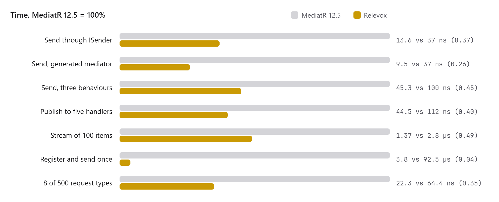
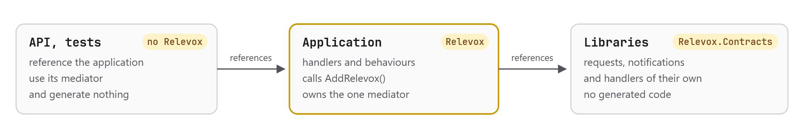
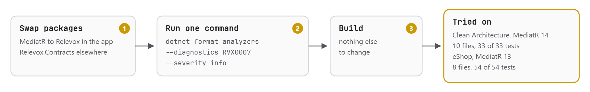
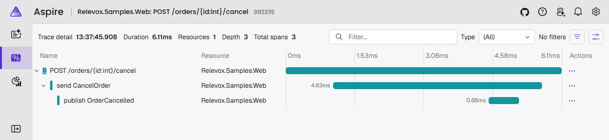
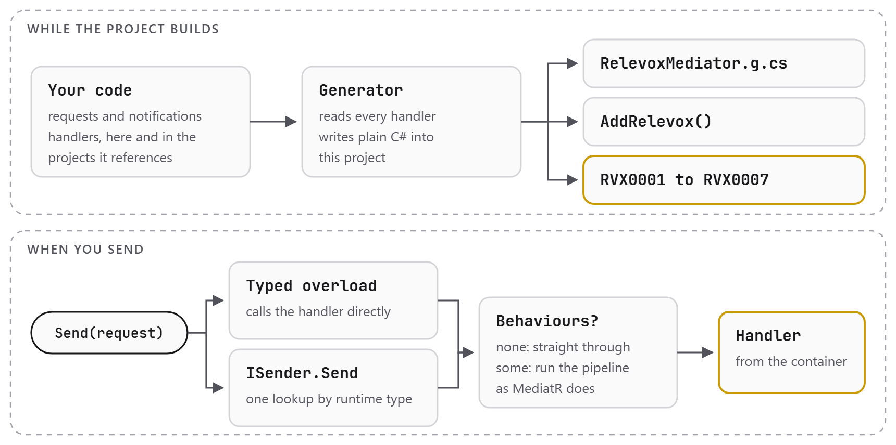

<p align="center">
  <picture>
    <source media="(prefers-color-scheme: dark)" srcset="docs/brand/relevox-mark-dark.svg">
    
  </picture>
</p>

# Relevox

[](https://www.nuget.org/packages/Relevox)
[](https://www.nuget.org/packages/Relevox)
[](https://github.com/tunahanaliozturk/relevox/actions/workflows/ci.yml)
[](https://github.com/tunahanaliozturk/relevox/actions/workflows/codeql.yml)
[](LICENSE)
[](https://dotnet.microsoft.com/download/dotnet/10.0)

A mediator for .NET whose dispatch is written by a source generator at build time, with the same handler
signatures as MediatR 12. MIT licensed, no licence key, no telemetry.

The name joins *relevo*, the relay race in Spanish and Portuguese, and *vox*, Latin for voice: the message
handed from runner to runner. A request goes the same way, through each behaviour to its handler.

```bash
dotnet add package Relevox             # the application, which calls AddRelevox
dotnet add package Relevox.Contracts   # libraries that only declare requests and handlers
dotnet add package Relevox.Testing     # test projects: a fake mediator and a notification recorder
```

| Package | Version | Downloads | Reference it from |
|---|---|---|---|
| [Relevox](https://www.nuget.org/packages/Relevox) | [](https://www.nuget.org/packages/Relevox) | [](https://www.nuget.org/packages/Relevox) | The application, the project that calls `AddRelevox`. It brings the source generator. |
| [Relevox.Contracts](https://www.nuget.org/packages/Relevox.Contracts) | [](https://www.nuget.org/packages/Relevox.Contracts) | [](https://www.nuget.org/packages/Relevox.Contracts) | Libraries that only declare requests and handlers. No dependencies. |
| [Relevox.Testing](https://www.nuget.org/packages/Relevox.Testing) | [](https://www.nuget.org/packages/Relevox.Testing) | [](https://www.nuget.org/packages/Relevox.Testing) | Test projects ([testing.md](docs/testing.md)). |

Releases and their notes are on the [releases page](https://github.com/tunahanaliozturk/relevox/releases) and in
[CHANGELOG.md](CHANGELOG.md).

## Why

MediatR 13 and later are licensed under RPL-1.5 or a commercial agreement and check a licence key at run
time. 12.5.0 is the last Apache-2.0 release and is frozen. Relevox is a place to move to without rewriting
anything:

- **Same signatures.** `IRequestHandler<TRequest, TResponse>.Handle(request, cancellationToken)` returning
  `Task<TResponse>`, the same pipeline behaviours, pre and post processors, exception handlers and actions,
  streams and notifications. Migrating changes packages, `using` directives and one registration call.
- **Same behaviour.** Every scenario in the [differential tests](tests/Relevox.DifferentialTests) runs on
  MediatR 12.5.0 and on Relevox, and the two must agree on results, handler order and exceptions, down to
  which processors run. [compatibility.md](docs/compatibility.md) lists what they pinned down.
- **Mistakes found by the compiler.** No assembly scanning. A request with no handler, or two, or a handler
  the application cannot call, is reported while building, with a [page per rule](docs/diagnostics.md).
- **Trimming and NativeAOT** without annotations. A sample is published with NativeAOT and run in CI.

## How fast

<picture>
  <source media="(prefers-color-scheme: dark)" srcset="docs/images/benchmarks-dark.png">
  
</picture>

Measured with BenchmarkDotNet 0.15.8 on an Intel Core Ultra 7 255H, .NET 10.0.13, Windows 11. Full tables,
and what each number does and does not show, are in
[docs/benchmark-results/2026-10-21-1.2.0.md](docs/benchmark-results/2026-10-21-1.2.0.md), measured for 1.2.0 with
telemetry off. The machine's own noise moves MediatR's send between 32 and 42 ns across runs, so compare the
ratios rather than the times.
With allocations:

| | MediatR 12.5 | Relevox | Relevox as a share of MediatR |
|---|---:|---:|---:|
| Send, through `ISender` | 37.0 ns, 128 B | 13.6 ns, 24 B | 0.37 |
| Send, through the generated mediator | 37.0 ns, 128 B | 9.5 ns, 24 B | 0.26 |
| Send with three behaviours | 100 ns, 656 B | 45.3 ns, 392 B | 0.45 |
| Publish to five handlers | 112 ns, 896 B | 44.5 ns, 120 B | 0.40 |
| Stream of 100 items | 2.80 µs, 592 B | 1.37 µs, 328 B | 0.49 |
| Register and send once | 92.5 µs | 3.8 µs | 0.04 |
| Eight request types in turn, of 500 | 64.4 ns | 22.3 ns | 0.35 |

Mediator 3.0, the other source-generated library, holds handlers as singletons by default, which Relevox does
on request; a typed send then takes about 1 ns in both. Mediator stays ahead on behaviours and publishing,
which it composes at build time. With transient handlers in both, Relevox's typed send is 8.8 ns against
Mediator's 29.6 ns. Mediator's handlers return `ValueTask`, so moving to it means rewriting them;
that is the trade [ADR 0002](docs/adr/0002-task-not-valuetask.md) explains.

## Quick start

<picture>
  <source media="(prefers-color-scheme: dark)" srcset="docs/images/project-layout-dark.png">
  
</picture>

The project that calls `AddRelevox` references `Relevox` and gets the one mediator. Libraries reference only
`Relevox.Contracts`, which has no dependencies. Projects above the application use its mediator.

```csharp
using Relevox;

builder.Services.AddRelevox();

public sealed record GetOrder(int Id) : IRequest<Order>;

public sealed class GetOrderHandler(OrderStore store) : IRequestHandler<GetOrder, Order>
{
    public Task<Order> Handle(GetOrder request, CancellationToken cancellationToken) =>
        store.FindAsync(request.Id, cancellationToken);
}

// Wherever ISender, IPublisher or IMediator is injected:
Order order = await sender.Send(new GetOrder(42), cancellationToken);
```

Behaviours, processors and lifetimes are configured as in MediatR:

```csharp
builder.Services.AddRelevox(options =>
{
    options.AddOpenBehavior(typeof(Validation<,>));
    options.AddOpenRequestPreProcessor(typeof(Stamp<>));
    options.HandlerLifetime = ServiceLifetime.Singleton;
});
```

## Moving from MediatR

<picture>
  <source media="(prefers-color-scheme: dark)" srcset="docs/images/migration-dark.png">
  
</picture>

The command rewrites `using MediatR`, `AddMediatR` and the scanning settings. In an IDE the same fix is
**Move from MediatR to Relevox**, applied to the whole solution. Both trials are written up in
[migration-trial.md](docs/migration-trial.md).

[docs/migration.md](docs/migration.md) has the details and the few deliberate differences.
[samples/Migration](samples/Migration) holds the same order service on both libraries; CI runs the two and
fails if their output differs. [samples/Relevox.Samples.Web](samples/Relevox.Samples.Web) is an ASP.NET Core
minimal API on Relevox, with its [`.http` file](samples/Relevox.Samples.Web/Relevox.Samples.Web.http) and tests that
drive it over HTTP.

## Testing

`Relevox.Testing` has a `FakeMediator` that answers what the test set up and records what was sent and
published, in place of a mocked `IMediator`, and a recorder for the notifications the real mediator publishes
in an integration test. [docs/testing.md](docs/testing.md) shows both, next to the Moq version.

## Telemetry

`options.Telemetry.Enabled = true` gives every send, publish and stream a span on the `Relevox` activity
source, named after the message, such as `send PlaceOrder`, and a `relevox.operation.duration` measurement on
the `Relevox` meter. [docs/telemetry.md](docs/telemetry.md) shows how to turn it on and what it emits. Off, it
costs a send nothing measurable; on with nothing listening, about 0.9 ns
([results](docs/benchmark-results/2026-10-21-telemetry.md)). The
[web sample](samples/Relevox.Samples.Web#seeing-the-telemetry) exports both over OTLP and shows how to watch them
in the standalone Aspire dashboard.

<picture>
  <source media="(prefers-color-scheme: dark)" srcset="docs/images/telemetry-dashboard-dark.png">
  
</picture>

## How it works

<picture>
  <source media="(prefers-color-scheme: dark)" srcset="docs/images/how-it-works-dark.png">
  
</picture>

Nothing is scanned at run time. `ISender.Send` costs one frozen-dictionary lookup, however many requests there
are, and a request with no behaviours skips the pipeline entirely.

## Decisions

- [1. Source-generated dispatch](docs/adr/0001-source-generated-dispatch.md)
- [2. Handlers return Task, not ValueTask](docs/adr/0002-task-not-valuetask.md)
- [3. Target net10.0 only](docs/adr/0003-net10-only.md)
- [4. Resolve handlers per call, by concrete type](docs/adr/0004-resolve-per-call.md)
- [5. No `namespace MediatR` shim](docs/adr/0005-no-mediatr-namespace-shim.md)
- [6. Clean-room rule, and MediatR 12.5.0 as the test oracle](docs/adr/0006-clean-room.md)
- [7. `AddRelevox` lives in `Microsoft.Extensions.DependencyInjection`](docs/adr/0007-addrelevox-namespace.md)
- [8. Generic handlers are closed at build time](docs/adr/0008-generic-handlers.md)
- [9. Generic notification handlers also close at run time](docs/adr/0009-open-notification-handlers-at-run-time.md)
- [10. The name: Relevox](docs/adr/0010-name-relevox.md)
- [11. `Relevox.Internal` is a contract between generated code and the runtime](docs/adr/0011-internal-api-is-a-contract.md)
- [12. A testing package with a fake mediator and a notification recorder](docs/adr/0012-testing-package.md)
- [13. Telemetry names, and telemetry off by default](docs/adr/0013-telemetry-names.md)
- [14. The message map leaves the build inside the assembly](docs/adr/0014-message-map-output.md)
- [15. What the message map says, and how the build learns about behaviours](docs/adr/0015-message-map-content.md)
- [16. The Markdown view of the message map is written by the generator](docs/adr/0016-message-map-markdown.md)
- [17. The message map records where each message is sent from](docs/adr/0017-message-map-call-sites.md)

## Roadmap

What comes next, version by version, is in [docs/roadmap.md](docs/roadmap.md).

## Building

The .NET 10 SDK is all it needs.

```bash
dotnet build Relevox.slnx
dotnet run --project tests/Relevox.SourceGenerator.Tests   # generator: output, diagnostics, incrementality
dotnet run --project tests/Relevox.DifferentialTests       # every scenario on MediatR 12.5.0 and on Relevox
bash eng/package-smoke.sh                                # pack, install into a new app, run it
dotnet run --project tools/Relevox.LicenseAudit -- .       # every dependency permissively licensed
```

The diagrams in this file are drawn by `tools/diagrams.py`; `CHROME=<path to Chrome or Edge> python tools/diagrams.py`
renders them again after a change.

[CONTRIBUTING.md](CONTRIBUTING.md) has the ground rules, including the clean-room rule: no code from
MediatR 13 or later.

## Licence

MIT.
