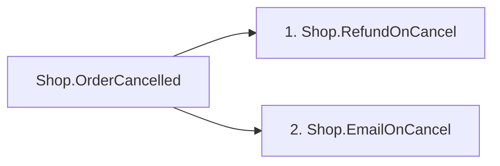

# The message map

The message map is a file that says what a project's mediator dispatches and what runs around each message.
The generator already knows this at build time; the map writes it down, so it can be read in a pull request or
checked in CI instead of found with grep.

How the map leaves the build is in [ADR 0014](adr/0014-message-map-output.md); what goes into it, and what the
build cannot see, is in [ADR 0015](adr/0015-message-map-content.md); the Markdown view is
[ADR 0016](adr/0016-message-map-markdown.md); call sites are [ADR 0017](adr/0017-message-map-call-sites.md), and
the calls of projects that use another project's mediator are [ADR 0021](adr/0021-solution-call-sites.md).

## Turning it on

In the project that calls `AddRelevox`, or for every project in `Directory.Build.props`:

```xml
<PropertyGroup>
  <RelevoxMessageMap>true</RelevoxMessageMap>
  <!-- Optional. Relative to the project; the default is under obj. -->
  <RelevoxMessageMapPath>message-map.json</RelevoxMessageMapPath>
</PropertyGroup>
```

Every build that compiles the project then writes the map, by default to
`obj/<configuration>/<framework>/relevox-message-map.json`, and a [Markdown view](#the-markdown-view) of it
next to it, `relevox-message-map.md` (with `RelevoxMessageMapPath`, the same path with `.md`). The files are only
rewritten when their content changes, so an edit that changes no message, handler or registration leaves them
alone. A project that uses another project's mediator, such as a web project above the application layer,
gets a map of the calls it makes ([below](#the-whole-solution)); one that makes none gets no files.

The map is written by a real build: `dotnet build`, or a build in Visual Studio or Rider. The IDE's background
design-time builds do not write it.

With the switch on, the map is also compiled into the assembly as the constants `RelevoxMessageMap.Json` and
`RelevoxMessageMap.Markdown`, which is where the build task reads it from. With it off, the generated code is the same as without this feature.

## An example

```json
{
  "schemaVersion": 1,
  "project": "Shop.Application",
  "requests": [
    {
      "type": "Shop.Orders.PlaceOrder",
      "response": "int",
      "project": "Shop.Contracts",
      "handler": {
        "type": "Shop.Orders.PlaceOrderHandler",
        "project": "Shop.Application"
      },
      "behaviors": [
        {
          "type": "Shop.Logging<Shop.Orders.PlaceOrder, int>",
          "project": "Shop.Application"
        },
        {
          "type": "Shop.Transaction<Shop.Orders.PlaceOrder, int>",
          "project": "Shop.Application"
        }
      ],
      "preProcessors": [],
      "postProcessors": [],
      "exceptionActions": [],
      "exceptionHandlers": [
        {
          "type": "Shop.Orders.OutOfStock",
          "project": "Shop.Application",
          "exception": "Shop.Orders.OutOfStockException"
        }
      ],
      "callSites": [
        {
          "file": "Orders/OrderEndpoints.cs",
          "line": 24
        }
      ]
    }
  ],
  "streams": [],
  "notifications": [
    {
      "type": "Shop.Orders.OrderPlaced",
      "project": "Shop.Contracts",
      "handlers": [
        {
          "type": "Shop.Billing.SendInvoice",
          "project": "Shop.Application"
        }
      ],
      "callSites": [
        {
          "file": "Orders/PlaceOrderHandler.cs",
          "line": 31
        }
      ]
    }
  ],
  "unread": []
}
```

## The Markdown view

The `.md` file is the same map for people: a table per request and stream with its pipeline from top to bottom
in the order it runs, and a Mermaid diagram per notification with its handlers in order. GitHub renders both, so
a committed copy reads well in a pull request. It is written from the same values as the JSON, in the same order,
so it changes exactly when the JSON does. Its layout is for reading and may change in any release; tools read
the JSON.

From the web sample, shortened:

````markdown
### `Shop.PlaceOrder`

Returns `int`. Declared in Relevox.Samples.Web.

Sent from `Program.cs:48`.

| Step | Type | Project |
|---|---|---|
| Pre-processor | `Shop.Received<Shop.PlaceOrder>` | Relevox.Samples.Web |
| Behaviour | `Shop.Validation<Shop.PlaceOrder, int>` | Relevox.Samples.Web |
| Handler | `Shop.PlaceOrderHandler` | Relevox.Samples.Web |

## Notifications

### `Shop.OrderCancelled`

Declared in Relevox.Samples.Web.

Published from `Orders.cs:89`.


````

Rendered:

### `Shop.PlaceOrder`

Returns `int`. Declared in Relevox.Samples.Web.

Sent from `Program.cs:48`.

| Step | Type | Project |
|---|---|---|
| Pre-processor | `Shop.Received<Shop.PlaceOrder>` | Relevox.Samples.Web |
| Behaviour | `Shop.Validation<Shop.PlaceOrder, int>` | Relevox.Samples.Web |
| Handler | `Shop.PlaceOrderHandler` | Relevox.Samples.Web |

### `Shop.OrderCancelled`

Declared in Relevox.Samples.Web.

Published from `Orders.cs:89`.


## Committing the map and checking it in CI

The map is most useful committed: a pull request that adds a handler, reorders a pipeline or sends a message
from somewhere new shows it in the diff. Three steps.

1. Write the map next to the project instead of under `obj`:

   ```xml
   <PropertyGroup>
     <RelevoxMessageMap>true</RelevoxMessageMap>
     <RelevoxMessageMapPath>message-map.json</RelevoxMessageMapPath>
   </PropertyGroup>
   ```

   The build then writes `message-map.json` and `message-map.md` in the project folder. Commit both.

   A project with several `<TargetFrameworks>` builds once per framework, and each build would write the same
   two files, the last one winning. Give each framework its own, and commit them all:

   ```xml
   <RelevoxMessageMapPath>$(TargetFramework).message-map.json</RelevoxMessageMapPath>
   ```

2. The files are written with `\n` line endings on every machine. Tell Git to keep them that way, or a checkout
   on Windows with `core.autocrlf` turns them into `\r\n` and the check below reports a change that is not one.
   In `.gitattributes`:

   ```gitattributes
   *message-map.json text eol=lf
   *message-map.md text eol=lf
   ```

3. After the build in CI, fail when the build changed the map, so a stale one cannot be merged:

   ```yaml
   - run: dotnet build --configuration Release

   - name: The message map is up to date
     run: |
       if [ -n "$(git status --porcelain -- '*message-map.json' '*message-map.md')" ]; then
         git --no-pager diff -- '*message-map.json' '*message-map.md'
         echo "::error::The message map changed. Build, then commit message-map.json and message-map.md."
         exit 1
       fi
   ```

   `git status` rather than `git diff` so a map that was never committed fails too. The step needs a POSIX
   shell, which `ubuntu-latest` and `macos-latest` have; on `windows-latest` add `shell: bash`.

This repository runs the same step on the package smoke application in `tests/Relevox.PackageSmoke`, whose map
is committed, and checks that the step fails once a line is added above the calls.

Call sites carry line numbers, so an edit that moves a call changes the map. That is the point: the diff says
where the call went. If that is more churn than a team wants, commit the map without checking it, or check only
the JSON with a tool that ignores `callSites`.

## The whole solution

Each map is written by one project's build, so on its own it lists the calls in that project. In a layered
solution the requests are declared and handled in one project and sent from another: the application layer
calls `AddRelevox`, the web project sends. With the switch on in both, the web project writes a map of its own
with nothing in `requests`, `streams` or `notifications` and its calls in `calls`:

```json
{
  "schemaVersion": 1,
  "project": "Shop.Web",
  "requests": [],
  "streams": [],
  "notifications": [],
  "unread": [],
  "calls": [
    {
      "type": "Shop.Orders.PlaceOrder",
      "callSites": [
        {
          "file": "Endpoints/Orders.cs",
          "line": 18
        }
      ]
    }
  ]
}
```

Its Markdown view lists the same calls under "Calls".

[message-map-combine.jq](message-map-combine.jq) puts the maps together. Copy it into the repository and run it
over every map:

```sh
jq --slurp --from-file message-map-combine.jq $(git ls-files '*message-map.json') > combined-message-map.json
```

The output is an array with one entry per mediator: its map, where each message's `callSites` holds the calls
from every project, each with a `project` field naming the project the call is in, sorted by project, file and
line. The maps under `obj` work as well, with `find . -name relevox-message-map.json -path '*/obj/*'` in place
of `git ls-files`.

### Requests nothing sends

A request with a handler and no call site in any project is either dead or sent in a way the build cannot see.
After the step above:

```yaml
- name: Every request is sent from somewhere
  run: |
    jq --slurp --from-file message-map-combine.jq $(git ls-files '*message-map.json') > combined-message-map.json
    unsent="$(jq -r '.[].requests[] | select(.callSites == []) | .type' combined-message-map.json)"
    if [ -n "$unsent" ]; then
      echo "::error::No project sends these requests:"
      echo "$unsent"
      exit 1
    fi
```

The check only knows the calls in the maps it is given. Leave out a project, and its calls are missing; add the
test projects, and a request sent only from a test counts as sent. A request the build cannot see being sent,
listed [below](#what-the-map-cannot-see), is reported; one sent as `object` on purpose, such as from a message
queue, can be filtered out by name:

```sh
jq -r '.[].requests[] | select(.callSites == []) | .type | select(. != "Shop.Orders.Replay")' combined-message-map.json
```

Notifications nobody publishes are not checked yet; `.[].notifications[] | select(.callSites == [])` lists them.

## The fields

The JSON schema is [message-map.schema.json](message-map.schema.json); a test checks generated maps against it.

Types are written as C# names with their namespaces and without `global::`: `Shop.Orders.PlaceOrder`,
`Shop.Paged<Shop.Order>`, `string`, `int?`. A project is an assembly name. Lists of messages are sorted by
type name; everything inside a message is in the order it runs.

### Top level

| Field | Type | Meaning |
|---|---|---|
| `schemaVersion` | number | `1`. Changes only if a field is removed or changes meaning, which 1.x never does. |
| `project` | string | The project whose mediator this is. |
| `requests` | array | Every request the mediator dispatches, sorted by `type`. |
| `streams` | array | Every stream request, sorted by `type`. |
| `notifications` | array | Every notification type the build saw, sorted by `type`. |
| `unread` | array of strings | Registrations in an `AddRelevox` options lambda that the build could not read, as written, such as `options.AddOpenBehavior(behaviorType)`. Behaviours and processors registered there are missing from the map. Empty when everything was read. |
| `calls` | array | Only in the map of a project that uses another project's mediator: each message type it sends, sorted by `type`, with its `callSites`. The four lists above are then empty. |
| `notMoved` | array | Only in the map of a project that sees MediatR, as one does while [the bridge](migration.md#one-feature-at-a-time) runs the two side by side: each message still handled on MediatR, [below](#not-moved-yet). |

### A request

| Field | Type | Meaning |
|---|---|---|
| `type` | string | The request type. A generic request appears once for each closing the build found, such as `Shop.Load<Shop.Order>`. Abstract requests are left out: they can never be sent as themselves. |
| `response` | string or null | The response type; `null` for a request that returns nothing. |
| `project` | string or null | The project the request type is declared in. |
| `handler` | component | The handler that runs. |
| `behaviors` | components | Pipeline behaviours added through the options, outermost first. An open behaviour appears closed over this request, and only when its constraints allow it, as the container decides. A behaviour with `[PipelineOrder]` is placed by it, as it runs, and has an `order` field ([ADR 0019](adr/0019-pipeline-order.md)). |
| `preProcessors` | components | Pre-processors, in the order they run. Empty unless the options add at least one, because only then does the pre-processor behaviour run ([compatibility](compatibility.md)). Processors found in the code are included when the options set `AutoRegisterRequestProcessors = true`. |
| `postProcessors` | components | The same for post-processors. |
| `exceptionActions` | exception components | Exception actions registered for this request, in the order they are tried for one exception type. Which ones run depends on the exception thrown: those for its type, then for each base type up to `Exception`. |
| `exceptionHandlers` | exception components | The same for exception handlers. |
| `callSites` | call sites | Where this project sends the request from. |

The pipeline, from the outside in: exception actions and exception handlers (actions outermost with the default
`ApplyForUnhandledExceptions` strategy, handlers outermost with `ApplyForAllExceptions`), then the
pre-processors, then the post-processors, then `behaviors`, then the handler. A behaviour with a negative
`order` runs outside all of them; the Markdown view lists it above the pre-processors.

### A stream

| Field | Type | Meaning |
|---|---|---|
| `type` | string | The stream request type. |
| `response` | string | The type of each item. |
| `project` | string or null | The project the type is declared in. |
| `handler` | component | The handler that runs. |
| `behaviors` | components | Stream behaviours added through the options, outermost first, placed by `[PipelineOrder]` where they have it. |
| `callSites` | call sites | Where this project creates the stream from. |

### A notification

| Field | Type | Meaning |
|---|---|---|
| `type` | string | The notification type. Abstract notification types are left out. |
| `project` | string or null | The project the type is declared in. |
| `handlers` | components | The handlers it reaches, in the order they run, including handlers written for a base type or interface and generic handlers closed at build time. |
| `callSites` | call sites | Where this project publishes the notification from. |

### A component

| Field | Type | Meaning |
|---|---|---|
| `type` | string | The class. |
| `project` | string or null | The project it is declared in; `null` if the build could not tell. |

A behaviour with `[PipelineOrder]` adds `order`, its number; one without has no `order` and runs as 0. An
exception component adds `exception`, the exception type it is registered for.

### Not moved yet

One entry per MediatR handler and the message it handles, in this project and in the projects it references
that use MediatR, sorted by message `type` and then by handler. A message that has moved, one whose handler
implements Relevox's interface, is not listed, even while it keeps MediatR's interface for callers. An empty list
means every handler is on Relevox and the bridge can go, which [RVX0016](diagnostics.md#rvx0016) also reports.

| Field | Type | Meaning |
|---|---|---|
| `type` | string | The message the handler handles. |
| `kind` | string | `request`, `stream` or `notification`. |
| `project` | string or null | The project the message is declared in. |
| `handler` | component | The MediatR handler. |

A referenced project's internal handlers are left out unless it grants `InternalsVisibleTo`, since a project
reference compiles against its public surface. The Markdown view lists the same messages under "Not moved yet".

### A call site

A `Send`, `Publish` or `CreateStream` call on `ISender`, `IPublisher`, `IMediator` or a class implementing one
of them, in this project, whose argument's type is the message's type where it is written. Sorted by file, then
line.

| Field | Type | Meaning |
|---|---|---|
| `file` | string | The file, relative to the project, with `/` between folders. A file outside the project folder, such as a linked one, is written by its name alone. The map never holds an absolute path. |
| `line` | number | The line of the method name, from 1. |
| `project` | string | Only in the [combined view](#the-whole-solution): the project the call is in. |

Moving a call to another line changes the map, so a committed map changes with edits above a call too.

## What the map cannot see

The map is what the build can know. Some things are only known when the application runs, or in another
project:

- **Behaviours and processors registered with the container directly**, such as
  `services.AddTransient(typeof(IPipelineBehavior<,>), typeof(Logging<,>))`. They run, but are not in the map.
  Registering them through the `AddRelevox` options instead puts them in it.
- **Options the build cannot read**: a `Type` held in a variable, a method passed to `AddRelevox` instead of a
  lambda, a call the options are handed to, such as `Configure(options)`, an extension method on them or
  `options.BehaviorsToRegister.Clear()`, a call while an extension method of the same name is in scope, which the call
  may pick instead, the options held in another variable, including the options a registration
  call returns, and a lambda or local function
  inside the options lambda that uses them, since it may run later or never. These are listed in `unread`.
  Another library's method that happens to be called `AddRelevox` is ignored.
- **Which of several `AddRelevox` calls runs first.** Only the first call to run applies its options; the next
  returns before calling its lambda. With more than one call in a project, the calls that pass options are
  listed in `unread` and their registrations are left out.
- **Branches in the options lambda.** A registration inside an `if` is in the map whether or not the branch is
  taken. A change to `AutoRegisterRequestProcessors` inside a branch or a loop is listed in `unread`.
- **Calls from other projects, in one map.** A project's map lists the calls in that project. A request sent
  from a web project to the application project's mediator is in the web project's map, under `calls`, not the
  application's; [combining the maps](#the-whole-solution) puts them together.
- **Calls whose message type is not known where they are written**: `Send(object)`, a message held as
  `IRequest<int>`, as another interface or as an abstract class, a message whose type is a generic method's type
  parameter, and calls made through a wrapper or an extension method of your own. These are left out, not
  guessed at.

## Compatibility

Within 1.x, fields are only added. A tool that reads the map should ignore fields it does not know. A field is
never removed or given a new meaning without a new `schemaVersion`, and that only happens in a major release.
