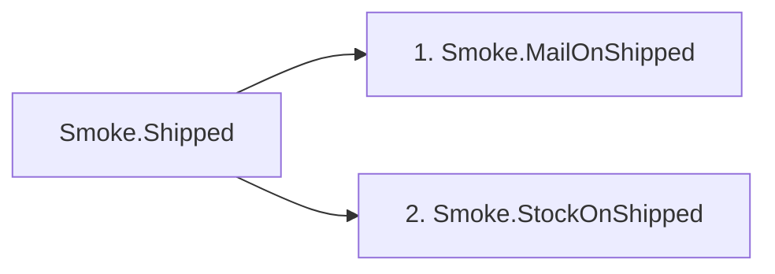

# Message map of Relevox.PackageSmoke

Written by the build from what Relevox's generator sees; the same map as JSON is in the file next to this one. Each table lists a message's pipeline from top to bottom in the order it runs. Behaviours wrap the handler, outermost first; exception handlers and actions wrap the whole pipeline and run only when it throws. They are listed as they run with the default RequestExceptionActionProcessorStrategy, handlers first; with ApplyForAllExceptions the actions run first.

## Requests

### `Smoke.Ping`

Returns `string`. Declared in Relevox.PackageSmoke.

Sent from `Program.cs:20`, `Program.cs:21`, `Program.cs:39`.

| Step | Type | Project |
|---|---|---|
| Behaviour | `Smoke.Counting<Smoke.Ping, string>` | Relevox.PackageSmoke |
| Handler | `Smoke.PingHandler` | Relevox.PackageSmoke |

### `Smoke.Touch`

Returns nothing. Declared in Relevox.PackageSmoke.

Sent from `Program.cs:22`.

| Step | Type | Project |
|---|---|---|
| Behaviour | `Smoke.Counting<Smoke.Touch, Relevox.Unit>` | Relevox.PackageSmoke |
| Handler | `Smoke.TouchHandler` | Relevox.PackageSmoke |

## Streams

### `Smoke.Count`

Yields `int`. Declared in Relevox.PackageSmoke.

Created from `Program.cs:30`.

| Step | Type | Project |
|---|---|---|
| Handler | `Smoke.CountHandler` | Relevox.PackageSmoke |

## Notifications

### `Smoke.Shipped`

Declared in Relevox.PackageSmoke.

Published from `Program.cs:26`.

